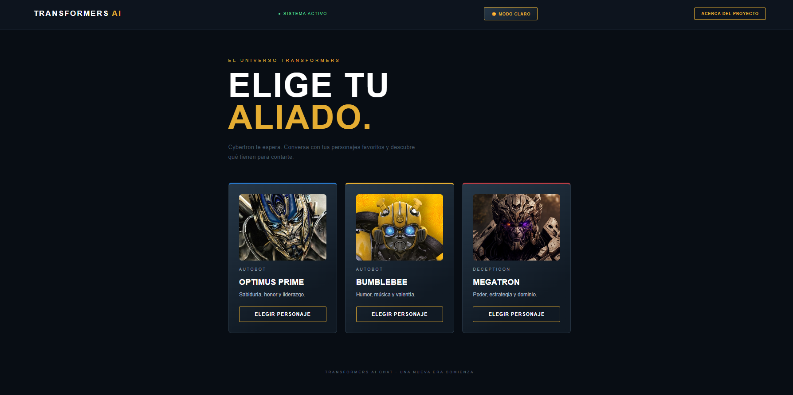
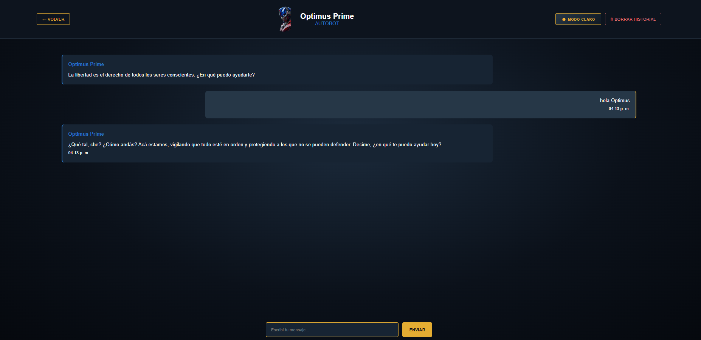
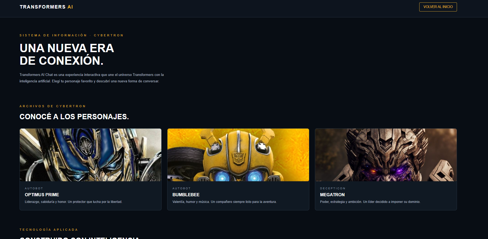

# Transformers AI Chat 🤖

## Descripción del proyecto

Transformers AI Chat es una aplicación web interactiva que desarrollé para conversar con personajes del universo Transformers mediante inteligencia artificial.

El proyecto cuenta con tres personajes:

- **Optimus Prime:** líder de los Autobots, con una personalidad noble y protectora.
- **Bumblebee:** un Autobot amigable que incorpora una radio musical, canciones y efectos de sonido.
- **Megatron:** líder de los Decepticons, con una personalidad dominante y desafiante.

Cada personaje tiene su propia personalidad e instrucciones para generar respuestas acordes a su identidad.

## Capturas de la aplicación

### Pantalla principal



### Chat con un personaje



### Sección About



## Funcionalidades principales

- Selección de personajes.
- Conversaciones dinámicas mediante inteligencia artificial.
- Personalidades diferenciadas para cada personaje.
- Historial de conversaciones independiente para cada personaje.
- Guardado automático del historial en el navegador mediante `localStorage`.
- Recuperación de las conversaciones al volver a ingresar desde el mismo navegador.
- Posibilidad de borrar el historial de cada personaje.
- Voces de bienvenida para Optimus Prime y Megatron.
- Radio musical de Bumblebee con selección de canciones.
- Efectos de sonido de sintonización y recursos de audio para Bumblebee.
- Modo claro y modo oscuro.
- Diseño responsive, adaptado a diferentes tamaños de pantalla.
- Interfaz visual inspirada en el universo Transformers.

## Tecnologías utilizadas

- HTML5.
- CSS3.
- JavaScript.
- Vite.
- Gemini API para generar las respuestas mediante inteligencia artificial.
- Vercel Functions para conectar de forma segura con Gemini.
- Vitest para realizar pruebas automatizadas.
- Git y GitHub para el control de versiones y almacenamiento del código.
- Vercel para el despliegue de la aplicación.

## Estructura general del proyecto

```text
Transformers-AI-Chat/
│
├── api/
│   └── chat.js
│
├── documentación/
│   └── capturas/
│       ├── home.png
│       ├── chat.png
│       ├── about.png
│       ├── home-final.png
│       ├── chat-final.png
│       └── about-final.png
│
├── public/
│   ├── audio/
│   │   ├── megatron-welcome.mp3
│   │   └── optimus-welcome.mp3
│   │
│   └── images/
│       ├── bee.png
│       ├── bumblebee.jpg
│       ├── megatron.jpg
│       ├── megatron2.png
│       ├── optimus.jpg
│       └── optimus2.png
│
├── src/
│   ├── app.js
│   ├── chat.js
│   ├── styles.css
│   └── utils.js
│
├── tests/
│   ├── app.test.js
│   └── utils.test.js
│
├── .env.example
├── .gitignore
├── index.html
├── package.json
├── package-lock.json
├── README.md
└── vite.config.mjs
```

## Instalación y ejecución local

### Requisitos previos

- Node.js instalado.
- Git instalado.
- Cuenta de Vercel.
- Vercel CLI instalada.

### Pasos para ejecutar el proyecto

1. Clonar el repositorio:

```bash
git clone https://github.com/Yamilalu/Transformers-AI-Chat.git
```

2. Ingresar a la carpeta del proyecto:

```bash
cd Transformers-AI-Chat
```

3. Instalar las dependencias:

```bash
npm install
```

4. Crear un archivo `.env` en la raíz del proyecto, tomando como referencia `.env.example`.

Configurar la clave de Gemini:

```env
GEMINI_API_KEY=tu_api_key_aqui
```

5. Iniciar el servidor local:

```bash
vercel dev
```

6. Abrir la aplicación en el navegador:

[http://localhost:3000](http://localhost:3000)

**Importante:** el archivo `.env` contiene información privada y no debe subirse al repositorio.

## Pruebas automatizadas

El proyecto utiliza Vitest para ejecutar pruebas automatizadas.

Para ejecutar las pruebas:

```bash
npm test
```

Las pruebas verifican:

- La validación de los mensajes.
- La limpieza del contenido ingresado.
- La validación de las respuestas.
- Diferentes comportamientos de la aplicación.

El proyecto cuenta con **10 pruebas automatizadas**, distribuidas en dos archivos de prueba.

## Despliegue

La aplicación está publicada en Vercel.

**Enlace público:**

https://transformers-ai-chat.vercel.app/

**Repositorio de GitHub:**

https://github.com/Yamilalu/Transformers-AI-Chat

El proyecto está conectado a GitHub con Vercel, por lo que los cambios enviados a la rama `main` pueden generar nuevos despliegues automáticamente.

La clave `GEMINI_API_KEY` está configurada como variable de entorno en Vercel para mantenerla protegida.

## Uso de inteligencia artificial

Durante el desarrollo utilicé ChatGPT como herramienta de apoyo para consultar conceptos, analizar errores, comprender fragmentos de código y explorar mejoras para la aplicación.

También utilicé Gemini API para generar las respuestas de los personajes dentro de la aplicación.

Las decisiones de diseño, la selección de funcionalidades, la integración de las herramientas y las pruebas fueron realizadas y verificadas durante el desarrollo del proyecto.